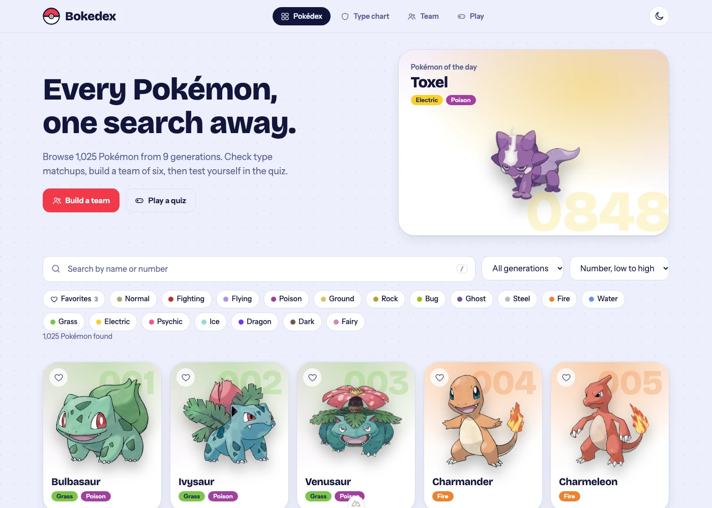
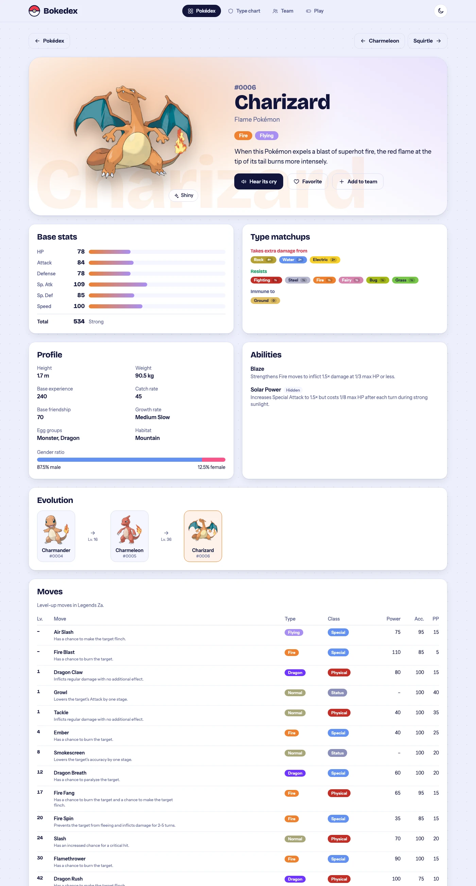
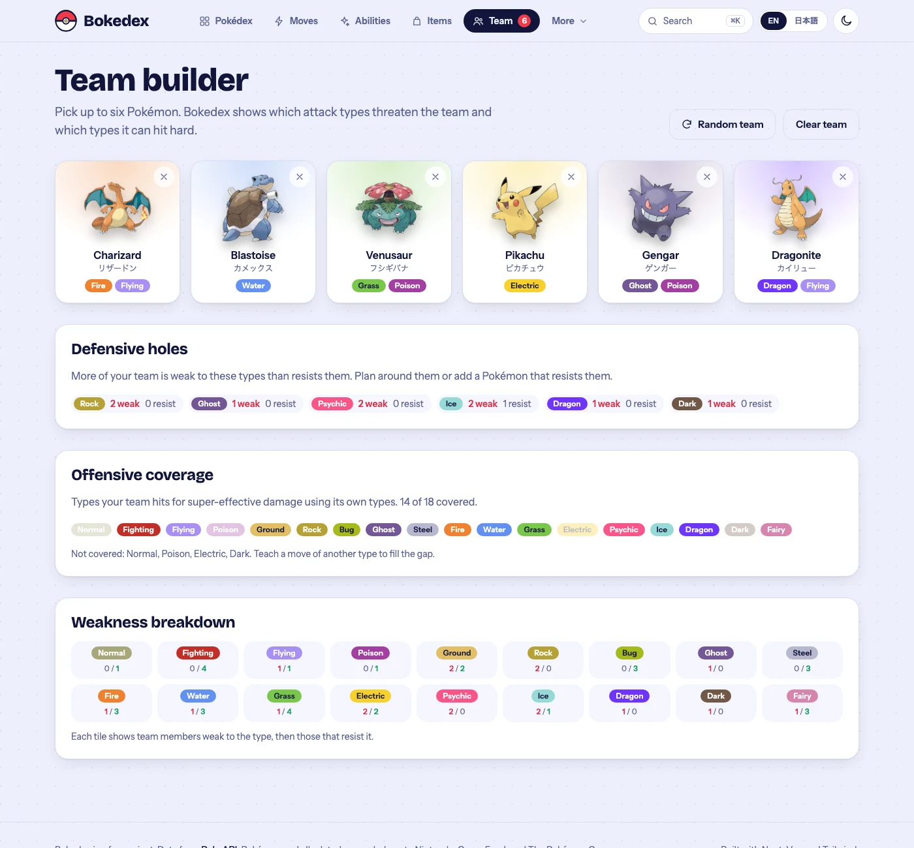
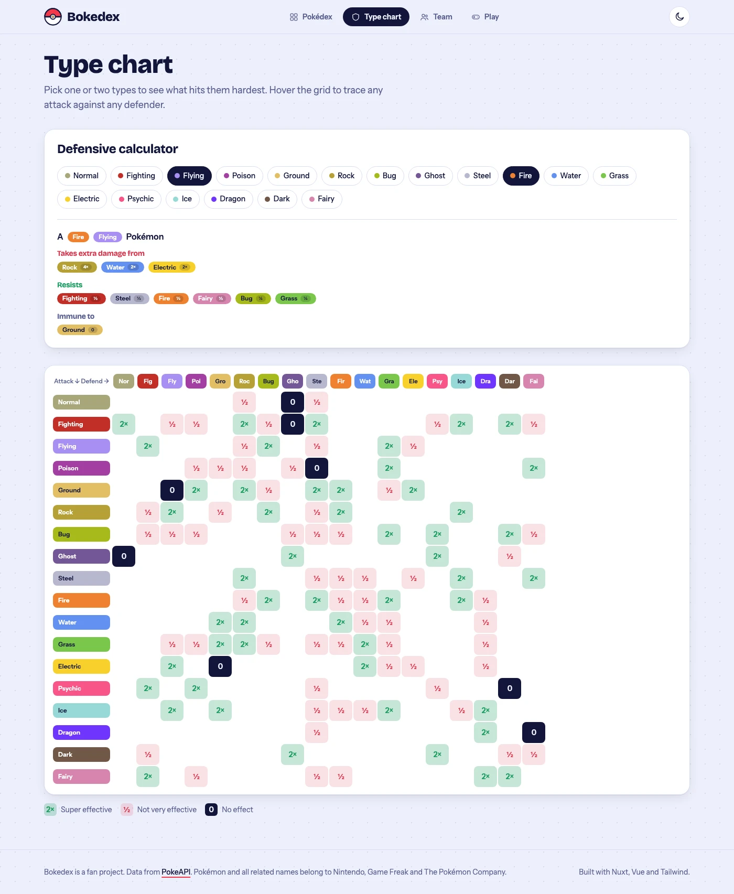
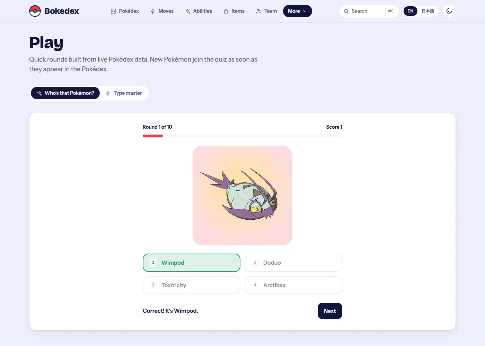

# Bokedex

A fast, animated Pokédex and game companion. Browse every Pokémon, check type matchups, build a team and play quizzes, all from live data.

Built with **Nuxt 4, Vue 3, Pinia, VueUse and Tailwind CSS 4**. Data comes from the free [PokeAPI](https://pokeapi.co).



| Detail | Team builder |
| --- | --- |
|  |  |

| Type chart | Quiz |
| --- | --- |
|  |  |

## Features

| Page | What it does |
| --- | --- |
| **Pokédex** `/` | Every Pokémon, with search by name or `#number`, type and generation filters, sorting, favorites and infinite scroll. Filters live in the URL, so a search can be shared. |
| **Detail** `/pokemon/:id` | Animated base stats, type matchups, abilities, profile (catch rate, gender ratio, egg groups), evolution tree with requirements, level-up moves with power, accuracy and PP, shiny toggle and cry audio. |
| **Type chart** `/types` | The full effectiveness matrix plus a one or two type defensive calculator. |
| **Team** `/team` | Six slots with shared weaknesses and offensive coverage analysis. |
| **Play** `/play` | *Who's that Pokémon?* and *Type master*, ten rounds each, with streaks and saved high scores. |

Also: dark mode, a card-to-hero shared-element transition, keyboard shortcuts (`/` to search, arrow keys between Pokémon, `1` to `4` in quizzes), reduced-motion support, and a mobile layout with bottom navigation.

## Quick start

Requires **Node 22.19+ or 24.11+**. Nuxt is installed locally by `npm install`; nothing is installed globally.

```bash
git clone https://github.com/bachbnt/bokedex.git
cd bokedex
npm install
npm run dev          # http://localhost:3000
```

| Script | Purpose |
| --- | --- |
| `npm run dev` | Development server with hot reload |
| `npm run build` | Production build into `.output/` |
| `node .output/server/index.mjs` | Run the production build |
| `npm run typecheck` | Type-check the app, server and shared code |

The first visit after startup takes a few seconds while the Pokédex index is built from PokeAPI. After that it is served from cache.

## Built to grow with PokeAPI

Nothing enumerates Pokémon, types or generations. When PokeAPI adds a Pokémon, a type or a generation, Bokedex picks it up after the cache refreshes (24 hours by default), with no code change or deploy. It also shows up in the filters, the type chart, team analysis and the quizzes.

The index is built from about 30 upstream calls regardless of how many Pokémon exist. See [Architecture](docs/ARCHITECTURE.md) for how.

## Documentation

| Document | Contents |
| --- | --- |
| [Architecture](docs/ARCHITECTURE.md) | System diagram, caching, API reference, data flow, state and persistence, conventions, limitations |
| [Design](docs/DESIGN.md) | Concept, tokens, screens, user flows, motion, accessibility, responsive behavior |

## Project structure

```text
server/   Nitro API: routes, PokeAPI client, caching, upstream types
shared/   Types and helpers used by both server and app
app/      Vue app: pages, components, composables, stores, utils
docs/     Architecture, design and screenshots
```

## Conventions

- **No relative `../` imports.** Use aliases: `~/` (app), `#shared/` (shared) and `#server/` (server).
- **No `any`.** PokeAPI payloads are typed in `server/types/pokeapi.ts`.
- `npm run typecheck` must pass. The root `tsconfig.json` points at the types Nuxt generates, which is also what makes the IDE resolve auto-imports such as `defineEventHandler`. If your editor shows red squiggles after a fresh clone, run `npm install` (it runs `nuxt prepare`) and restart the TypeScript server.

## Add a mini-game

1. Create a component in `app/components/game/`.
2. Call `useQuiz({ game, createQuestion })` for rounds, score and streak handling.
3. Add the key to `GameKey` in `app/stores/scores.ts`.
4. Register the game in `app/pages/play.vue`.

## Configuration

Override with environment variables (see [Architecture](docs/ARCHITECTURE.md#configuration)):

| Variable | Default |
| --- | --- |
| `NUXT_POKE_API_BASE` | `https://pokeapi.co/api/v2` |
| `NUXT_CACHE_MAX_AGE` | `86400` (seconds) |
| `NUXT_PUBLIC_SPRITE_BASE` | jsDelivr mirror of the PokeAPI sprites |
| `NUXT_PUBLIC_CRY_BASE` | jsDelivr mirror of the PokeAPI cries |

## Notes

- Moves show the newest game that has level-up data for that Pokémon, which can be a game with a shorter move list.
- By default the server cache lives in memory and resets on restart. Mount a persistent Nitro storage driver for production.

## Credits

Bokedex is an unofficial fan project. Data and sprites come from [PokeAPI](https://pokeapi.co). Pokémon and all related names belong to Nintendo, Game Freak and The Pokémon Company.
