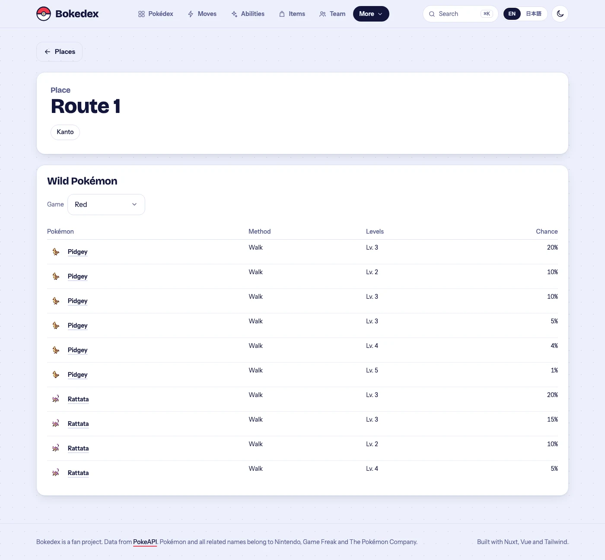

# Bokedex

A bilingual Pokémon encyclopedia: every Pokémon with all of its forms, every move, ability, item, berry and place, in **English and Japanese**, plus team, comparison and quiz tools.

**Live site: [bokedex.web.app](https://bokedex.web.app)** (English) and [bokedex.web.app/ja](https://bokedex.web.app/ja) (日本語)

Built with **Nuxt 4, Vue 3, Pinia, VueUse and Tailwind CSS 4**. Data comes from the free [PokeAPI](https://pokeapi.co), processed at build time into about 12,000 static pages.


| Pokémon page, Japanese | Pokémon page, with a Mega form |
| --- | --- |
|  |  |

## What's inside

| Section | What you can do |
| --- | --- |
| **Pokédex** `/` | Browse every Pokémon; search by name or number in English, kanji, kana or romaji; filter by type and generation; favorite. |
| **Pokémon** `/pokemon/25` | Stats and EV yield, type matchups, abilities, evolution with its conditions, **all alternate forms** (Mega, Gigantamax, regional, Primal, Origin...) each on its own page, **moves in every game** (level-up, TM, egg, tutor), **where to find it in every game**, held items, earlier-generation data, breeding and training facts, regional Pokédex numbers, entries for every game, and a gallery of sprites. |
| **Advanced search** `/pokemon` | Combine type, generation, ability, egg group, color, shape, habitat and a minimum stat; sort by any stat. |
| **Compare** `/compare` | Up to four Pokémon side by side. |
| **Stat calculator** `/calculator` | Real stats from base stats, level, nature, IVs and EVs. |
| **Moves, abilities, items, berries** | Sortable, filterable lists; details with effects, TM numbers, who learns, who holds. |
| **Z-Moves and Max Moves** `/battle-moves` | Every Z-Move and Max Move by type, how a move's power converts, and the converted move on each move's page. |
| **Types** `/types` | The full chart, a defensive calculator, and a page per type. |
| **Places** `/locations` | Wild Pokémon for every route, town and cave, per game, with method, level and chance. |
| **Games, Pokédexes, generations, regions, egg groups, natures** | The reference data around them. |
| **Team builder** `/team` | A team of six with a Tera type, nature, ability, level, IVs and EVs per member; real stats, and weakness and coverage analysis that follows the Tera types. |
| **Quizzes** `/play` | Five: silhouettes, the type chart, stat duels, name match (Japanese and English names) and abilities. |
| **Search** (`⌘K` / `Ctrl+K`) | One box across everything. |

Also: structured data (JSON-LD) and a sitemap for search engines, dark mode, a card-to-hero shared-element transition, keyboard shortcuts (`/` to search, arrow keys between Pokémon, `1` to `4` in quizzes), reduced-motion support and a mobile layout.

| Search | Compare | Place |
| --- | --- | --- |
|  |  |  |

## Quick start

Requires **Node 22.19+ or 24.11+** and Git. Nuxt is installed locally by `npm install`; nothing is installed globally.

```bash
git clone https://github.com/bachbnt/bokedex.git
cd bokedex
npm install
npm run dev          # http://localhost:3000
```

The first run clones PokeAPI's published data (about 600 MB, once) into `.cache/` and builds the datasets in a few seconds. After that `npm run dev` starts straight away.

| Script | Purpose |
| --- | --- |
| `npm run dev` | Development server with hot reload (builds the data first if it is missing or stale) |
| `npm run generate` | Build the whole static site into `.output/public` (about 75 seconds) |
| `npm run preview` | Serve the built site at `http://localhost:5002` with the production headers (needs the Firebase CLI) |
| `npm run ingest` | Build the datasets from PokeAPI. `-- --update` pulls the newest data, `-- --force` rebuilds, `-- --audit` lists untranslated terms |
| `npm run typecheck` | Type-check the app, server, shared code and scripts |
| `npm test` | Unit and integration tests |

## How it works

Everything is decided at build time. A pipeline reads PokeAPI's data and writes compact, bilingual datasets; Nuxt prerenders every page from them; the result is plain files on a CDN. There is no server and no runtime dependency on PokeAPI, which is why a Pokémon page opens in about a fifth of a second even on a slow connection.

The details, including measurements, the data model and how pages stay small, are in [Architecture](docs/ARCHITECTURE.md). The design thinking is in [Design](docs/DESIGN.md).

## Languages

Names come from PokeAPI in both languages and are shown together (the visitor's language first). PokeAPI has no Japanese for move, ability or item effects, so those show in English with a small "EN" badge. Lookup tables PokeAPI never translated use a hand-written Japanese glossary. To add another language, see [Adding a language](docs/ARCHITECTURE.md#adding-a-language).

## Deploy to Firebase Hosting

The site is live at **[bokedex.web.app](https://bokedex.web.app)** (Firebase project `bokedex`) on the **free Spark plan**; no Cloud Functions or billing are needed.

```bash
npm run generate
firebase deploy --only hosting --project bokedex --account <your-account-email>   # or: npm run deploy:firebase
```

To try the built site first, run `npm run preview`.

### Automatic weekly refresh

`.github/workflows/deploy.yml` typechecks, ingests the newest PokeAPI data, runs the tests, and deploys on every push to `main` and every Monday. A scheduled run does nothing when PokeAPI has not changed. Until you add a deploy key it still builds and tests, and skips only the deploy.

To enable the deploy step:

1. In the Firebase console open **Project settings, Service accounts**, and generate a new private key.
2. In GitHub open **Settings, Secrets and variables, Actions** and add a repository secret named `FIREBASE_SERVICE_ACCOUNT_BOKEDEX` containing the full JSON.

## Project structure

```text
scripts/ingest/   The data pipeline: PokeAPI data in, bilingual datasets out
shared/           The data model, locale helpers, kana normalization, route list
app/              Vue app: pages, components, composables, stores, utils
server/           Build-time routes that serve entities and datasets to the renderer
i18n/locales/     English and Japanese interface text
tests/            Unit and integration tests
docs/             Architecture, design and screenshots
```

## Conventions

- **No relative `../` imports.** Use aliases: `~/` (app), `#shared/` (shared), `#server/` (server), `#ingest/` (scripts).
- **No `any`.** PokeAPI payloads are typed in `scripts/ingest/raw.ts`.
- `npm run typecheck` and `npm test` must pass. If your editor shows red squiggles after a fresh clone, run `npm install` (it runs `nuxt prepare`) and restart the TypeScript server.
- Interface text goes in both `i18n/locales/en.json` and `ja.json`; the tests fail if they drift apart.

## Notes

- New Pokémon, moves and items appear after the next scheduled build (weekly), not instantly.
- PokeAPI gaps carry through: no Japanese effect text, no signature Gigantamax moves, and brand-new games are sometimes incomplete.
- The site is 748 MB on a 10 GB free allowance; Spark's daily transfer allowance (about 360 MB) is the number to watch if traffic grows.

## Credits

Bokedex is an unofficial fan project. Data comes from [PokeAPI](https://pokeapi.co); sprites and cries from the community [sprites](https://github.com/PokeAPI/sprites) and [cries](https://github.com/PokeAPI/cries) repositories. Pokémon and all related names belong to Nintendo, Game Freak and The Pokémon Company.
