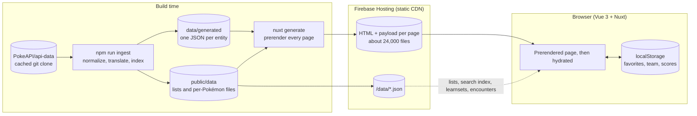

# Architecture

How Bokedex turns PokeAPI into a bilingual encyclopedia of about 12,000 static pages, why it stays fast and free to host, and the conventions the code follows.

Bokedex is a **static site**. Nothing runs on a server while people use it, so it hosts for free on Firebase Hosting's Spark plan.

## System overview



Two ideas carry the design:

1. **All data work happens at build time.** The browser never calls PokeAPI. A pipeline turns raw PokeAPI data into compact, bilingual datasets, and Nuxt prerenders every page from them.
2. **A page carries only what it mentions.** A Pokémon page does not embed the whole Pokédex to show three evolutions; the server attaches just the rows it references.

## The data pipeline (`scripts/ingest`)

`npm run ingest` reads [PokeAPI/api-data](https://github.com/PokeAPI/api-data), the published JSON of the whole API, from a shallow clone cached in `.cache/api-data`. Reading a local copy is deterministic, takes seconds, and puts no load on the PokeAPI servers (the same data over HTTP would be about 15,000 requests).

| Step | What it produces |
| --- | --- |
| Species and forms | One entry per species with every alternate form (Mega, Gigantamax, regional, Primal, Origin...) carrying its own types, stats, abilities, EV yield, held items and past-generation data |
| Evolutions | A structured tree (the conditions are data, rendered per language in the UI) |
| Learnsets and encounters | One small file per Pokémon form, loaded on demand |
| Moves, abilities, items, berries | Full entries plus compact list rows, with TM numbers, "learned by" and "held by" links |
| Types, natures, generations, games, Pokédexes, egg groups, growth rates | Reference data and the type chart |
| Locations and regions | Wild Pokémon per area, merged across games that share the same method, levels and chance |
| Taxonomy | Lookup tables (categories, habitats, targets...) merged with a hand-written Japanese glossary |
| Search index | One row per searchable thing, in every language |
| Sitemap and robots | Every page in every language with hreflang alternates. Rewritten on every run, even when the data is current, because the page list lives in code |

The run is skipped when the source commit has not changed; `--update` pulls the newest PokeAPI data and `--force` rebuilds regardless. The whole build takes about five seconds.

Outputs are split by who reads them:

| Location | Contents | Published? |
| --- | --- | --- |
| `data/generated/entities/<kind>/<key>.json` | One JSON per entity, read while prerendering | No |
| `public/data/*.json` | Lists (dex, moves, items...), taxonomy, search index | Yes |
| `public/data/learnsets/<id>.json`, `encounters/<id>.json` | Per-Pokémon files, fetched when that section scrolls into view | Yes |

### The data model

[`shared/types/encyclopedia.ts`](../shared/types/encyclopedia.ts) is the single contract between the pipeline and the app. Every translatable value carries all shipped languages:

```ts
interface Names { en: string; ja?: string; jaKana?: string; jaRoma?: string }
interface Text  { en?: string; ja?: string }
```

The UI picks one at render time (`useL10n`) and falls back to English when a translation does not exist upstream. Text that fell back is marked with a small "EN" badge so a reader always knows what language they are reading.

## Rendering: every page is prerendered

| Pages | How |
| --- | --- |
| About 6,000 entities per language (Pokémon and forms, moves, abilities, items, places, types, generations, games, Pokédexes, regions, egg groups) | One prerendered HTML file and one payload file each, written to `/pokemon/25`, `/ja/moves/thunderbolt`, ... |
| List and tool pages (Pokédex, moves, items, advanced search, compare, calculator...) | Prerendered shell that loads its list from `/data/*.json` |
| Unknown URLs | A real `404.html` with a 404 status |

Measured on the current data: **24,344 routes prerender in about 75 seconds**, producing 26,700 files and 748 MB. A typical Pokémon page costs about 10 KB of gzipped HTML plus 11 KB of payload; the heaviest pages (the national Pokédex, and moves hundreds of Pokémon learn) are about 100 KB.

### Entity payloads and `refs`

An entity page is built from `GET /api/entity/<kind>/<key>`, a server route used only while prerendering and in `nuxt dev`. It returns the entity plus `refs`: the small rows of everything the entity mentions (the Pokémon in an evolution line, the abilities of a form, the labels for its egg groups). `useEntity` hands `refs` to every component below the page, and `useLabels` turns slugs into names.

Without `refs`, each of the 12,000 pages would embed whole datasets (the Pokédex is 150 KB) and the site would be over a gigabyte larger.

Two details matter:

- A component cannot inject what it provides itself, so the page that calls `useEntity` (or `useTaxonomyRefs` on a list page) passes the returned `refs` to its own labels: `useLabels(refs)`. Components below it just call `useLabels()`.

- Type names (18 of them, about 1 KB) appear on almost every page, so they ship once per page as global core data instead of through `refs`.
- Each table in `refs.taxonomy` keeps the source table's order, which is chronological for games, so pages can sort versions without loading another dataset.

### Datasets and the dev server

List pages need the whole table, so they load `/data/<name>.json`. While rendering (prerender or `nuxt dev`) the server cannot always fetch its own static files (the dev server, not Nitro, serves `public/`, which once caused a render loop), so on the server `datasetUrl()` points at `/api/data/<name>` instead. The browser always reads the static file.

Sections that load on demand (learnsets, encounters) are `client-only` and `hydrate-on-visible`, so a table is never baked into thousands of pages.

## Internationalization

- `@nuxtjs/i18n` with `en` at the root and `ja` under `/ja`; every route exists in both and links to its twin through `hreflang`.
- UI text lives in `i18n/locales/{en,ja}.json`. `tests/integration/i18n.test.ts` fails if the two files differ in keys, if code uses a key that is not defined, or if a long Japanese string is just a copy of the English one.
- **Names** come from PokeAPI in both languages. Pages show the visitor's language first and the other as a smaller second line.
- **Descriptions**: PokeAPI has Japanese flavor text for some games, but no Japanese for move, ability or item effects. Those fall back to English with the badge.
- **Lookup tables** PokeAPI never translated (habitats, shapes, item categories, move targets, encounter methods, Pokédexes...) are filled from `scripts/ingest/glossary.ts`, written by hand using the games' own terms. Anything still missing falls back to English; `npm run ingest -- --audit` lists what remains.
- **Search** normalizes everything to one form (width-folded, lowercase, katakana, no spaces or punctuation), so "ピカ", "ぴか", "Pikachu" and "pika" all match.
- Full-width letters and digits in Japanese names (`１０まんボルト`) are written as normal ones (`10まんボルト`), as the games show them; Japanese punctuation is kept.

### Adding a language

`Names` and `Text` currently name their languages explicitly, so a third language is a small, mechanical change rather than a configuration entry:

1. Add the code to `LOCALES` and `LANGUAGE_PREFIXES` (`shared/utils/locales.ts`, `shared/utils/routes.ts`) and to the `i18n` block in `nuxt.config.ts`.
2. Add the field to `Names` and `Text`, read it in `scripts/ingest/l10n.ts`, and teach `pickName`/`pickText` about it.
3. Copy `i18n/locales/en.json` to the new language and translate it (the test lists anything missing).
4. Extend `scripts/ingest/glossary.ts` for the terms PokeAPI lacks.

### Structured data

Each entity page adds schema.org JSON-LD through `useEntitySchema`: a `WebPage` about the thing (both-language name, image, description) with a `BreadcrumbList` (Bokedex, section, page); the home page adds a `WebSite` with a search box. The builders are plain functions in `shared/utils/jsonld.ts`, and the serializer escapes `<` so a name can never close the script tag.

### Z-Moves and Max Moves

PokeAPI has these moves with names in both languages, but not the rule that turns a regular move into one of them. `shared/utils/battle-moves.ts` holds the one hand-written part, the power conversion tables, and picks the moves by type and damage class. Names come from the move data, and the server adds the two converted moves to a move's `refs`, so a move page carries them without loading the move list. Signature Gigantamax moves are not in PokeAPI and are not shown.

### Adding a kind of page

Add its builder under `scripts/ingest/build/`, write its entities in `scripts/ingest/index.ts`, add the type to `EntityByKind`, list what it mentions in `server/utils/refs.ts`, and create the page under `app/pages/`. The route list and sitemap come from the pipeline, and the build fails if any page cannot render.

## Frontend structure

```text
app/
  pages/          one folder per section: pokemon, moves, abilities, items, berries, locations, types,
                  natures, games, pokedex, generations, regions, egg-groups, compare, calculator, team, play
  components/     PokemonPage (and its sections), SearchDialog, FilterBar, EntityHeader, PokemonGrid, quiz/*
  composables/    useEntity, useDataset, useL10n, useUrlState, useDex, useTypeChart, useSearchIndex, useQuiz...
  stores/         collection (favorites, team) · scores (quiz records)
  utils/          dex filtering, type colors, stat formula, navigation
server/
  api/            entity/[kind]/[key], data/[name]   (build-time and dev only)
  utils/          store (reads the generated data), refs (what each entity references)
shared/           the data model, locale helpers, kana normalization, route list
scripts/ingest/   the pipeline
tests/            unit and integration tests
```

### Filters in the URL

List pages keep their state in the URL through `useUrlState`, so a view can be shared. On a prerendered page Nuxt hydrates with the query string stripped (to match the static HTML) and applies the real query right afterwards, so the URL is followed with a watcher rather than read once. The hook also recognises the echo of its own URL updates, so quick typing is never overwritten.

### State and persistence

Favorites, the team, each member's build (Tera type, nature, ability, level, IVs, EVs) and quiz scores live in Pinia setup stores backed by VueUse `useLocalStorage`. `initOnMounted` makes the prerendered HTML and the first client render agree (both empty). Builds are stored in their own key, keyed by Pokémon id, so a team saved before builds existed still loads, and `normalizeBuild` repairs any saved or hand-edited build (clamps levels, IVs and EVs, enforces 252 per stat and 510 in total). Each persisted ref goes through `skipHydrate(...)`: without it Pinia assigns the build-time empty state during hydration, VueUse writes that back, and the saved data is wiped on every full page load.

## Testing

| Layer | What | Command |
| --- | --- | --- |
| Types | App, server, shared code and scripts, through the root `tsconfig.json` | `npm run typecheck` |
| Unit | Search and filtering, kana, localized text, stat formula, team builds, quiz questions, Z/Max conversion, JSON-LD, ingest helpers, sitemap | `npm test` |
| Integration | Translation parity and usage; the generated data (every route has an entity, types and learnsets resolve, key tables are translated) | `npm test` |

Pages are also checked in a real browser against the production build (see "Deployment").

## Deployment

`npm run generate` ingests (if the source changed) and writes the site to `.output/public`. `firebase.json` serves it with cleanUrls and these headers:

| Rule | Effect |
| --- | --- |
| `/_nuxt/**` immutable, 1 year | Hashed build assets are cached forever |
| `/data/**`, 1 hour | Lists, learnsets and the manifest refresh within an hour of a deploy |
| Images, fonts, 1 day | |

`.github/workflows/deploy.yml` typechecks, ingests the newest PokeAPI data, tests, and deploys on every push to `main` and every Monday. A scheduled run compares the live site's `manifest.json` with the new one and does nothing if PokeAPI has not changed.

## Conventions

- **No `../` imports.** Use aliases: `~/` (app), `#shared/` (shared), `#server/` (server), `#ingest/` (scripts).
- **No `any`.** PokeAPI payloads are typed in `scripts/ingest/raw.ts`, declaring only the fields we read.
- `npm run typecheck` and `npm test` must pass; the root `tsconfig.json` references the types Nuxt generates, which is also what makes the IDE resolve auto-imports.
- **Accessibility is not optional:** visible focus, `aria-pressed` on toggles, `aria-live` result counts, reduced-motion support, keyboard paths for search and the quizzes.

## Trade-offs and limitations

Choosing a static site buys free hosting, speed and no server to run. In return:

- **New Pokémon wait for a rebuild.** They appear after the next scheduled run (weekly), not instantly.
- **PokeAPI gaps carry through.** There is no Japanese for effect text, no signature G-Max moves, and brand-new games are sometimes incomplete. Missing translations fall back to English and are labelled.
- **Free-tier headroom.** The site is 748 MB of 10 GB, but Spark's daily transfer allowance is about 360 MB; a crawler fetching thousands of pages in one day could use a good share. If traffic grows, put a free CDN in front or move to Blaze.
- **Build memory.** Prerendering peaks around 2.2 GB, fine for CI runners.
- **Fan project.** Names, artwork and cries belong to their owners; artwork is loaded from the community sprite repository, not redistributed.
