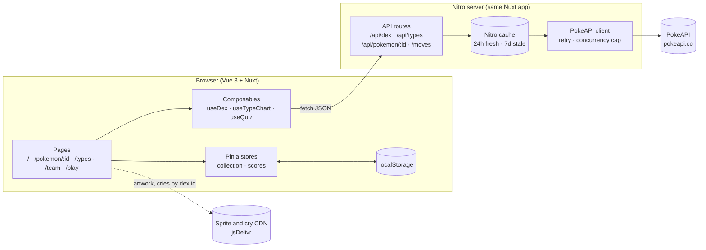
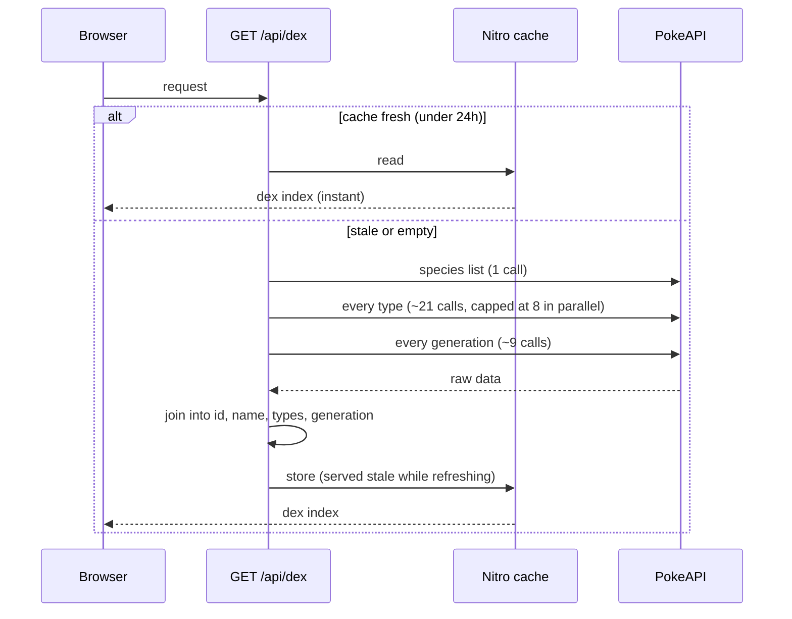
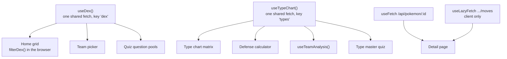

# Architecture

How Bokedex is put together, why it scales as PokeAPI grows, and the conventions the code follows.

## System overview



The browser never talks to PokeAPI. Every request goes through Nitro, which caches, retries and reshapes the data into small payloads the UI can use directly. Artwork and cries are the one exception: they are static files whose URL is derived from the dex id.

## Why it scales when new Pokémon are added

Nothing in the code lists Pokémon, types or generations. The index is rebuilt from the API, so growth upstream flows through on its own.



| Concern | How it is handled |
| --- | --- |
| More Pokémon | The species list is read at runtime. Each type endpoint already lists its members, so types come for free with no per-Pokémon request. Cost is about 30 calls whether there are 1,000 or 2,000 Pokémon. |
| New types | Filters, the chart, the calculator, team analysis and quizzes are all built from `/api/types`. An unknown type gets a stable color derived from its name (`app/utils/types.ts`). |
| New generations | The generation filter and quiz settings are built from the API. |
| Missing artwork | URLs are built from the dex id; the card falls back to the pixel sprite on error. |
| Half-published Pokémon | Species with no types yet are hidden until upstream finishes them. |
| Upstream outage | Stale cache is served for up to 7 days. Errors surface as a 502 and the UI shows a retry state. |
| Self-hosting | Point `pokeApiBase` and `spriteBase` at a mirror (see Configuration). |

## API

All routes are read-only `GET`s that return JSON and set a short browser cache (`max-age=300`, `stale-while-revalidate=86400`).

| Route | Returns | Upstream calls (cold) | Errors |
| --- | --- | --- | --- |
| `/api/dex` | Compact index: `total`, `generations`, `types`, and `pokemon[]` of `{ id, name, types, gen }` | about 30 | 502 |
| `/api/types` | Damage relations for each type that has Pokémon | shared with the index | 502 |
| `/api/pokemon/:id` | Stats, abilities with effects, flavor text, profile, evolution tree, cry URL | about 5 | 400 invalid id, 404 unknown |
| `/api/pokemon/:id/moves` | Newest level-up moves with power, accuracy, PP and effect, plus names of TM/tutor/egg moves | 1 + up to 40 | 400, 502 |

Response shapes live in [`shared/types/pokedex.ts`](../shared/types/pokedex.ts) and are imported by both the server and the app, so a change breaks the build on both sides at once. The upstream PokeAPI shapes are typed in [`server/types/pokeapi.ts`](../server/types/pokeapi.ts), declaring only the fields we read.

Moves are a separate route on purpose: they cost one upstream call per move, so the detail page paints first and moves load afterwards.

## Frontend structure

```
app/
  pages/          index · pokemon/[id] · types · team · play
  components/     PokemonCard (holo tilt) · StatBars · EvolutionTree · TypeChartMatrix
                  FilterBar · PokemonPicker · MoveTable · game/*
  composables/    useDex · useTypeChart · useTeamAnalysis · useQuiz · useTilt · useCry · useSprites
  stores/         collection (favorites, team) · scores (quiz records)
  utils/          dex filtering and sorting · type colors · stat metadata · nav
server/
  api/            route handlers (thin: validate, call util, map errors)
  utils/          pokeapi client · dex index · pokemon detail and moves · param parsing
  types/          upstream PokeAPI shapes
shared/
  types/          contracts shared by server and app
  utils/          titleCase · padDexId
```

### Data flow in the app



- **Filtering is client-side.** The index is about 60 KB gzipped, so search, type, generation, sort and favorites run instantly with no request. Rendering is chunked (48 cards at a time, loaded by an `IntersectionObserver`), so thousands of Pokémon stay smooth.
- **Filter state lives in the URL** (`?q=&type=&gen=&sort=&fav=`) so a view can be shared.
- **Type effectiveness** is computed from damage relations by `useTypeChart`; there is no hardcoded chart to keep in sync.

### State and persistence

Favorites, the team and quiz scores live in Pinia setup stores backed by VueUse `useLocalStorage`.

Two details matter and are easy to get wrong:

1. `initOnMounted: true` makes the server render and the first client render agree (both empty), then loads the saved value after mount. This avoids hydration mismatches.
2. Each persisted ref is returned through `skipHydrate(...)`. Without it, Pinia assigns the server's empty state to the ref during hydration, VueUse writes that back to `localStorage`, and the saved team or favorites are wiped on every full page load.

### Games

Both quizzes use `useQuiz`, which owns rounds, score, streak and the best-score record. A game supplies only how to create a question and whether an answer is right. To add a game, follow the steps in the [README](../README.md#add-a-mini-game).

## Conventions

- **No `../` imports.** Use aliases:

  | Alias | Points to | Use in |
  | --- | --- | --- |
  | `~/` | `app/` | app code |
  | `#shared/` | `shared/` | server and app |
  | `#server/` | `server/` | server code (declared in `nuxt.config.ts`) |

  Framework functions (`defineEventHandler`, `useFetch`, `ref`, ...) and app composables, components and stores are auto-imported by Nuxt.
- **No `any`.** Upstream payloads are typed; unknown shapes are narrowed rather than cast.
- **Typecheck everything:** `npm run typecheck` checks the Vue app, the Nitro server and shared code through the root `tsconfig.json` (project references into `.nuxt/`). This is the same configuration the IDE uses.
- **Server handlers stay thin:** validate input, call a util, map failures to HTTP errors with a `message`.
- **Accessibility is not optional:** visible focus, `aria-pressed` on toggles, reduced-motion support, keyboard paths for the quizzes.

## Configuration

Set in `nuxt.config.ts` under `runtimeConfig`; override with environment variables.

| Setting | Env variable | Default |
| --- | --- | --- |
| `pokeApiBase` | `NUXT_POKE_API_BASE` | `https://pokeapi.co/api/v2` |
| `cacheMaxAge` (seconds) | `NUXT_CACHE_MAX_AGE` | `86400` |
| `public.spriteBase` | `NUXT_PUBLIC_SPRITE_BASE` | jsDelivr mirror of the PokeAPI sprites repo |
| `public.cryBase` | `NUXT_PUBLIC_CRY_BASE` | jsDelivr mirror of the PokeAPI cries repo |

## Known limitations

- **Moves show one game.** Each Pokémon shows the newest game that has level-up data, which can be a game with a shorter move list (for example Legends Z-A). A game selector would need one upstream call per move per game.
- **Cold start.** The first visit after the cache is empty takes a few seconds while the index builds.
- **In-memory cache by default.** Nitro's default storage resets on restart. For production, mount a persistent driver (Redis, filesystem, or your platform's KV) through Nitro `storage`.
- **No automated tests yet.** Typechecking and manual checks cover the project today. The pure logic (`filterDex`, `matchesQuery`, `useTypeChart`, `describeCondition`) is the best place to start.
