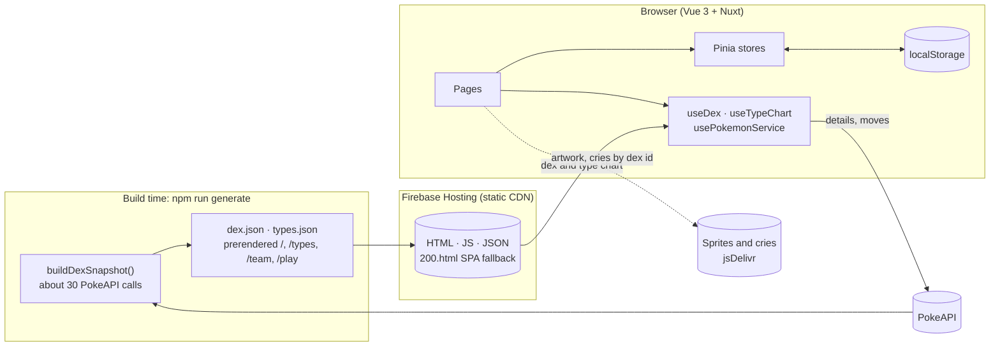
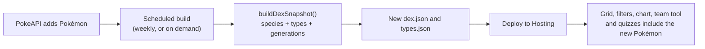
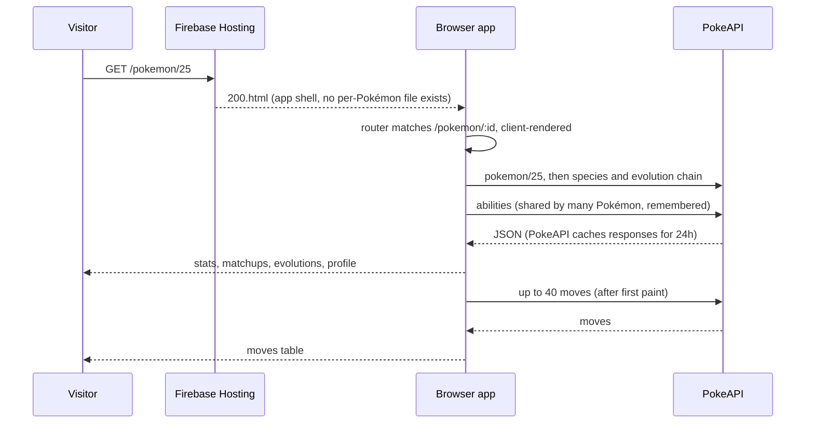
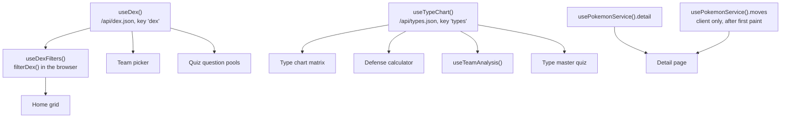

# Architecture

How Bokedex is put together, how it stays current as PokeAPI grows, and the conventions the code follows.

Bokedex is a **static site**. Nothing runs on a server while people use it, so it hosts for free on Firebase Hosting's Spark plan.

## System overview



Two data paths, chosen by how often the data changes and how much of it there is:

| Data | Source | Why |
| --- | --- | --- |
| The Pokédex index (id, name, types, generation) and the type chart | **Baked into static JSON at build time** | Needed on every page, small (about 60 KB), and only changes when Pokémon are added |
| One Pokémon's details and moves | **Fetched from PokeAPI by the browser** when you open it | There are too many to prerender (a thousand details, tens of thousands of moves), and PokeAPI allows browser requests (`access-control-allow-origin: *`) |

## Keeping up with new Pokémon

Nothing in the code lists Pokémon, types or generations. The snapshot is rebuilt from the API, so growth upstream flows through on the next build.



| Concern | How it is handled |
| --- | --- |
| More Pokémon | The species list is read at build time. Each type endpoint already lists its members, so types come for free with no per-Pokémon request. Cost is about 30 calls whether there are 1,000 or 2,000 Pokémon. |
| New types and generations | Filters, the chart, calculator, team analysis and quizzes are built from the snapshot. An unknown type gets a stable color derived from its name (`app/utils/types.ts`). |
| Between rebuilds | A Pokémon that is not in the snapshot yet is not listed, but opening `/pokemon/<id>` directly still works because details come live from PokeAPI. |
| Missing artwork | URLs are built from the dex id; the card falls back to the pixel sprite on error. |
| Half-published Pokémon | Species with no types yet are hidden until upstream finishes them. |
| Refresh cadence | `.github/workflows/deploy.yml` rebuilds and deploys weekly and on every push to `main`. You can also run it by hand from the Actions tab. |
| Self-hosting the data | Point `pokeApiBase` and `spriteBase` at a mirror (see Configuration). |

## Loading a Pokémon



`usePokemonService` keeps a lookup cache for the page session, and PokeAPI sends `cache-control: max-age=86400`, so revisiting a Pokémon is instant.

## Data layer

All aggregation lives in [`shared/pokeapi/`](../shared/pokeapi) as plain TypeScript on top of the standard `fetch`, so the same code runs in Node at build time and in the browser.

| File | Responsibility |
| --- | --- |
| `client.ts` | Fetch with timeout and retry (404s are not retried), concurrency cap, helpers |
| `types.ts` | Shapes of the PokeAPI responses we read; only the fields we use are declared |
| `dex.ts` | `buildDexSnapshot`: index and type chart from about 30 calls |
| `pokemon.ts` | `createPokemonService`: details and moves with per-session caching |

Response shapes the UI consumes live in [`shared/types/pokedex.ts`](../shared/types/pokedex.ts). A change there breaks the build on both sides at once.

The only server code is the build-time snapshot: `server/api/dex.json.get.ts` and `server/api/types.json.get.ts` are prerendered into `/api/dex.json` and `/api/types.json`. During `nuxt dev` the same routes run live, cached for an hour.

## Frontend structure

```text
app/
  pages/          index · pokemon/[id] · types · team · play
  components/     PokemonCard (holo tilt) · StatBars · EvolutionTree · TypeChartMatrix
                  FilterBar · PokemonPicker · MoveTable · game/*
  composables/    useDex · useDexFilters · useTypeChart · useTeamAnalysis · usePokemonService
                  useQuiz · useTilt · useCry · useSprites
  stores/         collection (favorites, team) · scores (quiz records)
  utils/          dex filtering and sorting · type colors · stat metadata · nav
server/
  api/            dex.json · types.json (prerendered at build)
  utils/          snapshot (cached builder used by the routes)
shared/
  pokeapi/        client · raw types · snapshot builder · Pokémon service
  types/          contracts shared by server and app
  utils/          titleCase · padDexId
```

### Rendering strategy

| Route | Rendering | Notes |
| --- | --- | --- |
| `/`, `/types`, `/team`, `/play` | Prerendered at build | First paint already contains the grid (48 cards in the HTML); Vue then hydrates |
| `/pokemon/:id` | Client-rendered (`routeRules: { ssr: false }`) | Served by the `200.html` fallback via the Hosting rewrite |
| Anything else | `200.html`, then the app's own 404 page | |

### Data flow in the app



- **Filtering is client-side.** The index is small enough that search, type, generation, sort and favorites run instantly with no request. Rendering is chunked (48 cards at a time, loaded by an `IntersectionObserver`), so thousands of Pokémon stay smooth.
- **Filters live in the URL** (`?q=&type=&gen=&sort=&fav=`) so a view can be shared. See "Prerendered pages and the URL" below.
- **Type effectiveness** is computed from damage relations by `useTypeChart`; there is no hardcoded chart to keep in sync.

### State and persistence

Favorites, the team and quiz scores live in Pinia setup stores backed by VueUse `useLocalStorage`. Two details are easy to get wrong:

1. `initOnMounted: true` makes the prerendered HTML and the first client render agree (both empty), then loads the saved value after mount. This avoids hydration mismatches.
2. Each persisted ref is returned through `skipHydrate(...)`. Without it, Pinia assigns the build-time empty state to the ref during hydration, VueUse writes that back to `localStorage`, and the saved team or favorites are wiped on every full page load.

### Prerendered pages and the URL

On a prerendered page, Nuxt hydrates with the query string stripped so the first render matches the static HTML, then applies the real query. Reading `route.query` once during setup therefore misses it, and a shared link like `/?type=fire` would lose its filter. `useDexFilters` and the `/play` page follow the URL with a watcher instead, and ignore the echo of their own URL updates so quick typing is never overwritten.

### Games

Both quizzes use `useQuiz`, which owns rounds, score, streak and the best-score record. A game supplies only how to create a question and whether an answer is right. To add a game, follow the steps in the [README](../README.md#add-a-mini-game).

## Conventions

- **No `../` imports.** Use aliases:

  | Alias | Points to | Use in |
  | --- | --- | --- |
  | `~/` | `app/` | app code |
  | `#shared/` | `shared/` | server and app |
  | `#server/` | `server/` | server code (declared in `nuxt.config.ts`) |

  Framework functions (`defineEventHandler`, `useFetch`, `ref`, ...) and app composables, components and stores are auto-imported by Nuxt.
- **No `any`.** Upstream payloads are typed; unknown shapes are narrowed rather than cast.
- **Typecheck everything:** `npm run typecheck` checks the Vue app, the Nitro server and shared code through the root `tsconfig.json` (project references into `.nuxt/`). This is the same configuration the IDE uses.
- **Accessibility is not optional:** visible focus, `aria-pressed` on toggles, reduced-motion support, keyboard paths for the quizzes.

## Deployment

`npm run generate` writes the site to `.output/public`; `firebase.json` serves it with these rules:

| Rule | Effect |
| --- | --- |
| `cleanUrls` | `/types` serves `types/index.html` |
| Rewrite `**` to `/200.html` | Any path without a file (such as `/pokemon/25`) loads the app shell |
| `/_nuxt/**` immutable, 1 year | Hashed build assets are cached forever |
| `/api/*.json`, 1 hour | The snapshot refreshes within an hour of a deploy |

## Configuration

Set in `nuxt.config.ts` under `runtimeConfig.public`; override with environment variables at build time.

| Setting | Env variable | Default |
| --- | --- | --- |
| `pokeApiBase` | `NUXT_PUBLIC_POKE_API_BASE` | `https://pokeapi.co/api/v2` |
| `spriteBase` | `NUXT_PUBLIC_SPRITE_BASE` | jsDelivr mirror of the PokeAPI sprites repo |
| `cryBase` | `NUXT_PUBLIC_CRY_BASE` | jsDelivr mirror of the PokeAPI cries repo |

## Trade-offs and limitations

Choosing a static site buys free hosting and no server to run. In return:

- **New Pokémon wait for a rebuild.** They appear in the grid after the next deploy (weekly by default), not instantly.
- **Detail pages are not server-rendered.** There is no per-Pokémon HTML for search engines or social link previews. The home page is prerendered, but `/pokemon/:id` is an app shell until the browser loads the data.
- **No server cache or stale fallback for details.** Each visitor's browser calls PokeAPI, relying on its 24 hour HTTP cache. If PokeAPI is down, a Pokémon that visitor has not opened yet fails with a retry prompt.
- **Moves show one game.** Each Pokémon shows the newest game that has level-up data, which can be a game with a shorter move list (for example Legends Z-A).
- **Load on PokeAPI scales with visitors.** Traffic goes straight to a free community API; if Bokedex grows large, mirror PokeAPI and set `pokeApiBase`.
- **No automated tests yet.** Typechecking and a browser check cover the project today. The pure logic (`filterDex`, `matchesQuery`, `useTypeChart`, `describeCondition`) is the best place to start.
