# Design

The thinking behind how Bokedex looks, moves and flows.

## Concept

**A holo-card binder.** Every Pokémon is a collectible card that tilts under the pointer and carries its own type colors. The card is also the navigation: click it and its artwork morphs into the hero of the detail page. That one moment is where the design spends its boldness. Everything around it stays calm so the Pokémon remain the loudest thing on screen.

Audience: Pokémon fans and players who want to look something up quickly, plan a team, or check a matchup mid-game.

Primary job: get from "what was that Pokémon?" to the answer in two clicks, then keep the reference data (types, moves, evolutions) one tap away.

## Principles

1. **Color comes from the subject.** The UI chrome is neutral; the accent on any card or detail page is the Pokémon's own type colors, so the interface feels different for Charizard and Blastoise without extra decoration.
2. **One memorable motion.** The tilt and the card-to-hero morph carry the personality. Other motion answers an action (bars filling, answers revealing) rather than decorating idle screens.
3. **Reference data stays scannable.** Numbers use tabular figures, tables align, and risks use red and green consistently (weakness, resistance).
4. **Plain words.** Sentence case, active verbs, no filler. Empty and error states say what happened and what to do.

## Design tokens

### Color

| Token | Light | Dark | Role |
| --- | --- | --- | --- |
| `--bg` | `#edeffb` | `#0b0e26` | Page background |
| `--surface` | `#ffffff` | `#151a40` | Cards and panels |
| `--surface-2` | `#f5f6fe` | `#1b2150` | Inset areas, tracks |
| `--ink` | `#12163a` | `#eef0ff` | Text and primary buttons |
| `--muted` | `#5b6190` | `#9aa1d6` | Secondary text |
| `--line` | `#d9ddf3` | `#262c5e` | Borders |
| `--brand` | `#f2384a` | same | Primary action, streaks |
| `--glow` | `#ffc93c` | same | Highlights, legendary badge |
| `--poke`, `--poke-2` | per Pokémon | per Pokémon | Primary and secondary type color, set on each card and detail page |

Type colors are defined in `app/utils/types.ts`. Text on a type color is chosen by WCAG luminance (`readableInk`) so a yellow Electric badge gets dark text and a purple Dragon badge gets white. Unknown future types get a color derived from their name.

### Typography

| Use | Face | Why |
| --- | --- | --- |
| Display and numerals | Bricolage Grotesque (500, 700, 800) | Characterful and compact; the dex numbers and names carry the personality |
| Body and UI | Instrument Sans (400 to 600) | Quiet and legible at small sizes |

Headlines use tight tracking (`-0.02em`) and a line height of 1.1; body text stays under about 70 characters per line.

### Shape, depth and spacing

Large radii (20 to 36px) on panels and cards, pill shapes for chips and badges. One soft shadow token for all raised surfaces. A faint dot grid on the page background nods to a scanner screen without competing with content.

## Screens

| Screen | Purpose | Light | Dark or mobile |
| --- | --- | --- | --- |
| Pokédex (`/`) | Find any Pokémon: search, filter, sort, favorite | 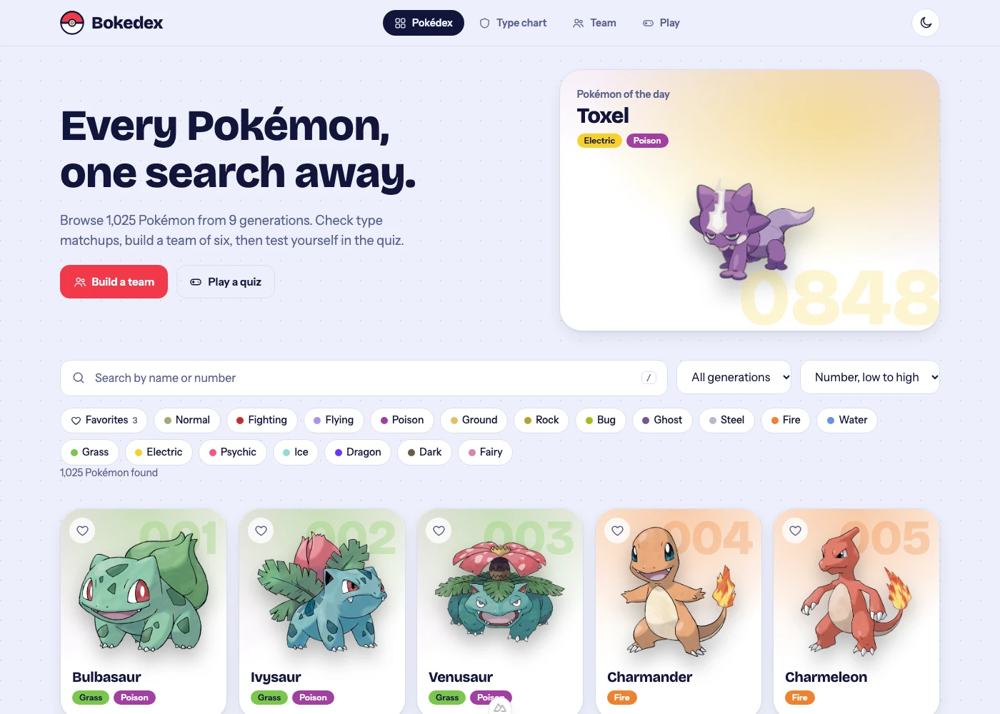 | 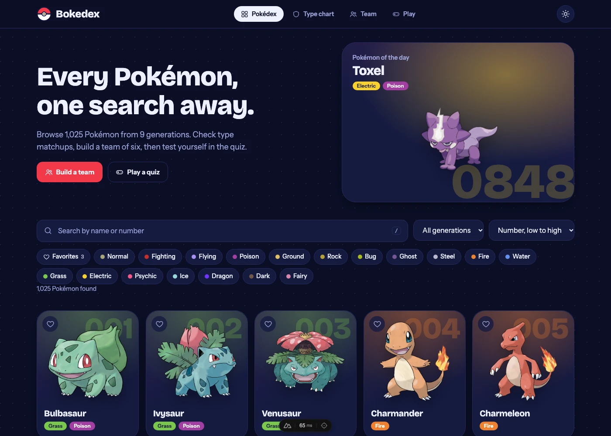 |
| Detail (`/pokemon/:id`) | Everything about one Pokémon | 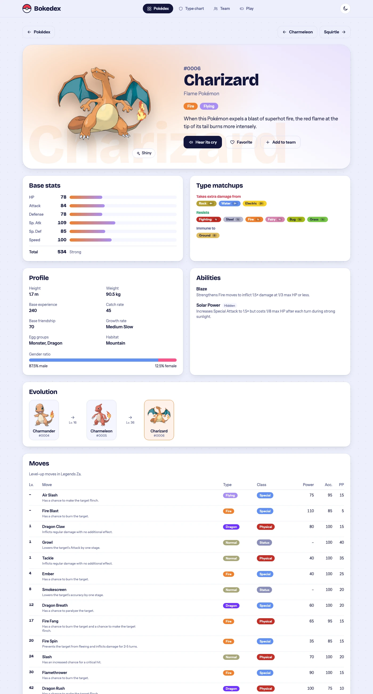 | 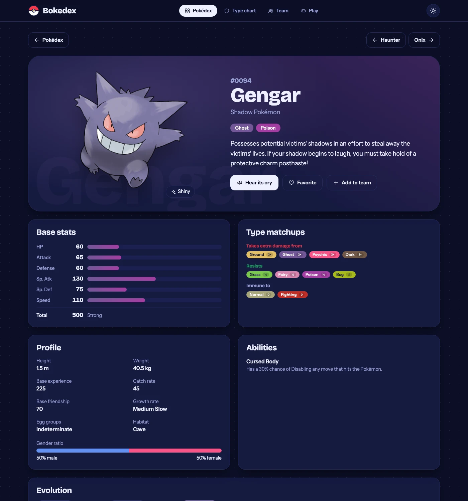 |
| Type chart (`/types`) | Look up and calculate matchups | 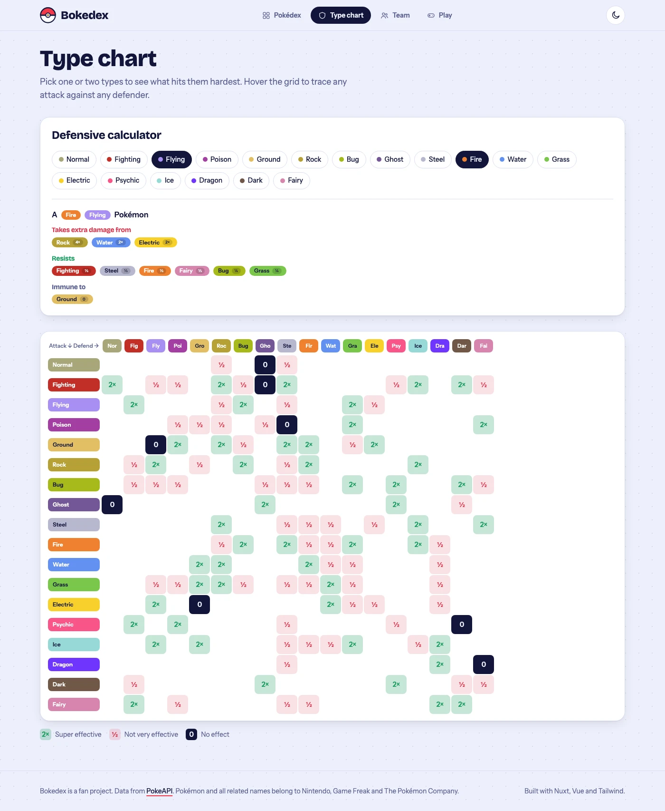 | |
| Team (`/team`) | Build six and find the holes | 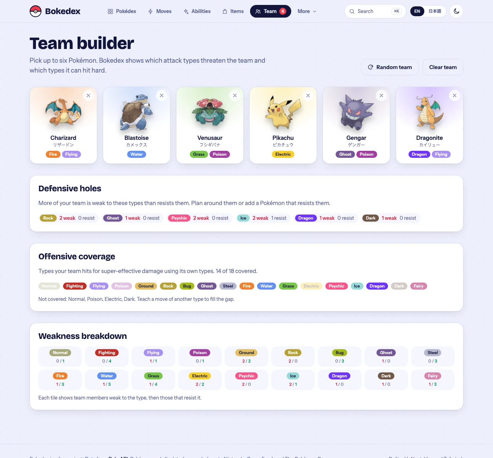 |  |
| Play (`/play`) | Two quick quizzes |  |  |

### Key components

| Card under the pointer | Evolution tree (Eevee) |
| --- | --- |
| 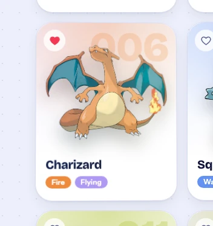 |  |

## User flows

### Overall navigation

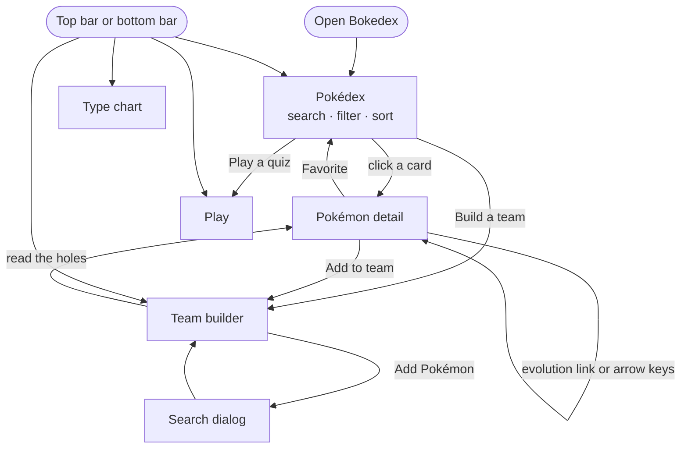

### Find a Pokémon

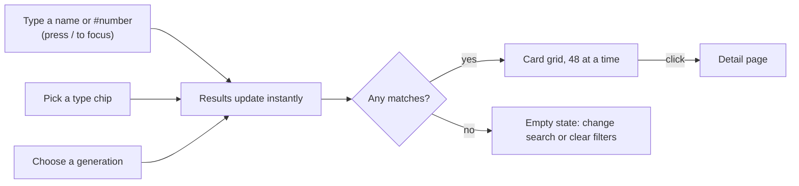

Filters are written to the URL, so a filtered view can be copied and shared.

### Build and check a team

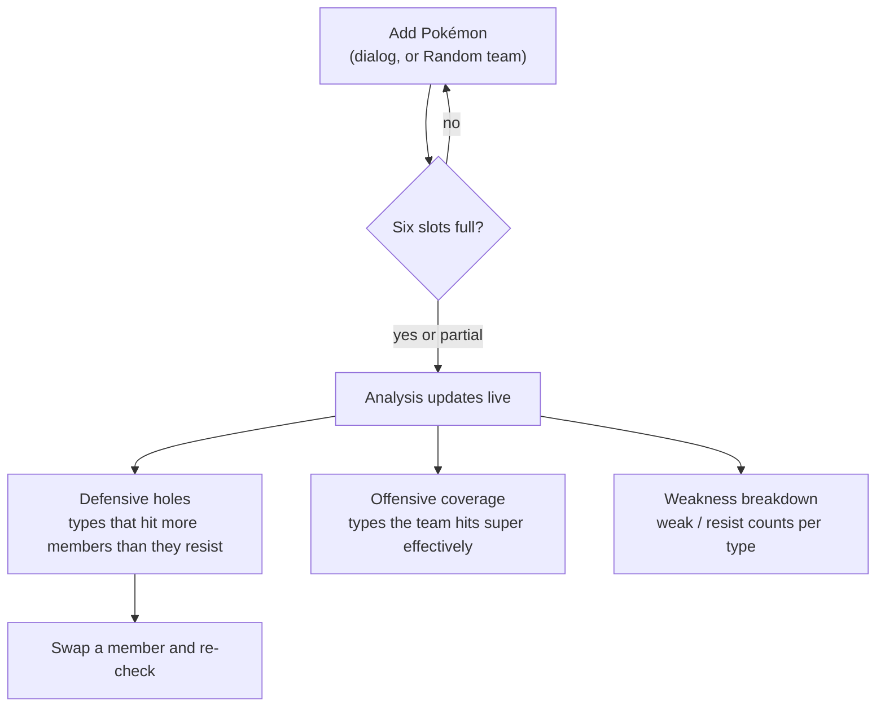

### Play a quiz

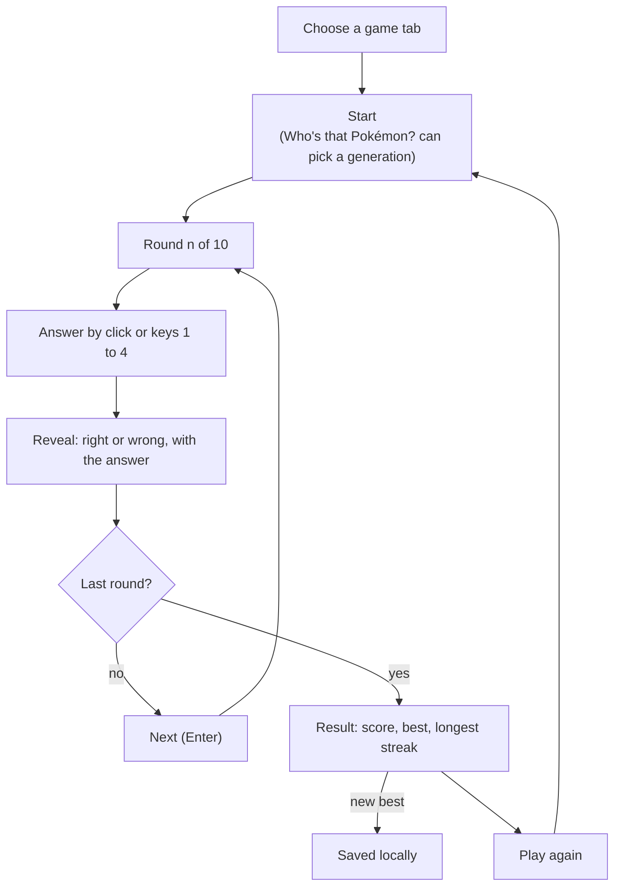

## Motion

| Motion | Trigger | Purpose |
| --- | --- | --- |
| Card tilt and holographic sheen | Pointer over a card | The signature interaction; the sheen follows the pointer |
| Card to hero morph | Click a card | Shows that the detail page is the same Pokémon, enlarged (View Transitions API) |
| Float on detail and daily pick | Idle | Gentle life on the one hero image per page |
| Stat bars fill | Page load | Makes relative strength readable at a glance |
| Silhouette reveal | Answering | Confirms the answer; the silhouette becomes full color |
| Shake on wrong answer | Wrong answer | Immediate, non-punishing feedback |
| List enter, leave, move | Filtering | Shows what changed when results update |

All motion respects `prefers-reduced-motion`: animations and transitions collapse to near-zero and the card tilt is disabled.

## Accessibility

- Visible focus ring on every interactive element (3px, with offset). Hover lift and focus rings were scanned across every page at desktop and mobile widths to confirm scroll containers never clip them.
- Buttons that toggle state use `aria-pressed`; meters and progress use `role="meter"` and `role="progressbar"`.
- Text on type colors is contrast-checked by luminance; type is never conveyed by color alone (every badge carries its name).
- Skip link to main content; `aria-live` regions announce result counts and quiz feedback.
- Keyboard: `/` focuses search, left and right arrows move between Pokémon on the detail page, `1` to `4` answer quizzes, `Enter` continues, `Esc` closes the picker.
- Native `<dialog>` for the Pokémon picker gives focus trapping and Escape handling for free.

## Responsive behavior

| Width | Behavior |
| --- | --- |
| Under 768px | Bottom pill navigation instead of the top links; type chips scroll horizontally; wide tables and the type matrix scroll inside their panel |
| Card grid | 2 columns, 3 from 640px, 4 from 1024px, 5 from 1280px |
| 1024px and up | The detail page lays stats, matchups, profile and abilities out in two columns |

| Pokédex | Detail | Team |
| --- | --- | --- |
| 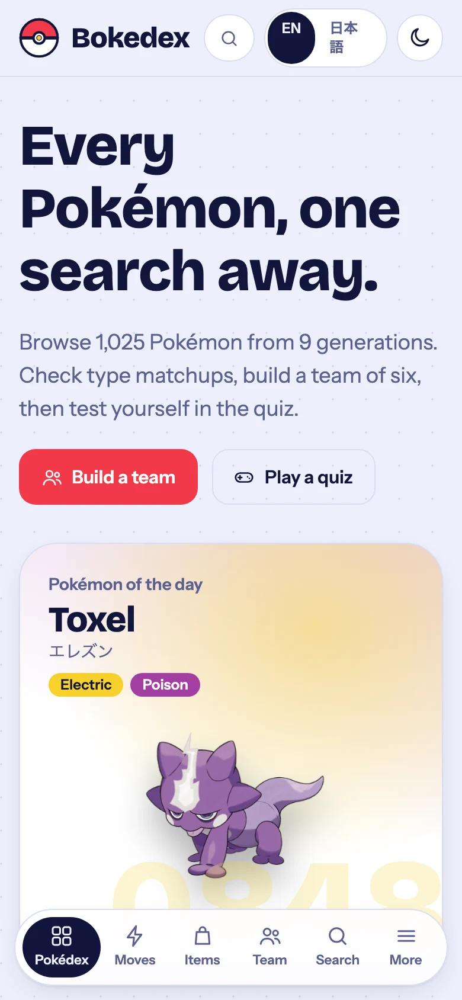 | 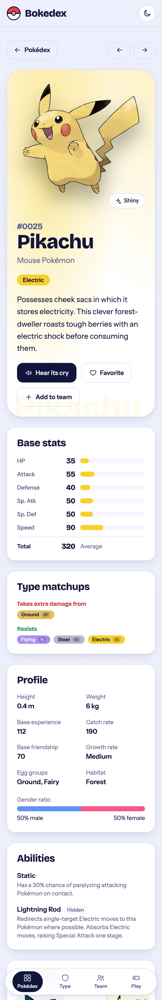 |  |

## Voice

Sentence case, plain verbs, and one name per action ("Add to team" becomes "On your team"). Errors say what failed and what to do next ("The data service didn't respond. Check your connection and try again.") and never apologize. Empty screens invite the next step ("Add a Pokémon to see weaknesses and coverage").
